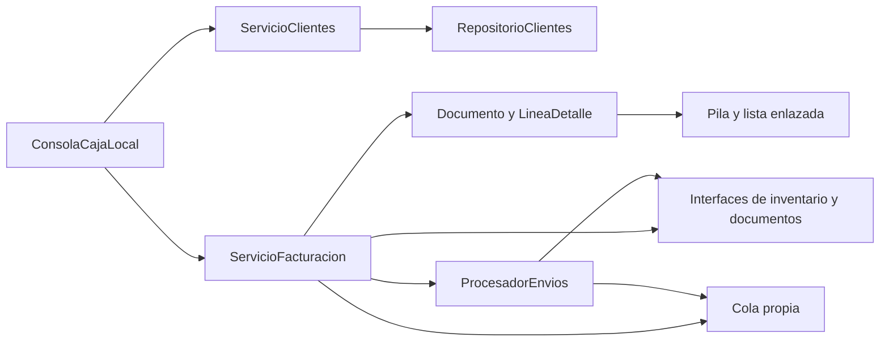

# SIFAC · Entrega 1

Proyecto Java con Ant para Apache NetBeans. La caja local consulta el padrón sintético, factura con un catálogo en memoria y procesa documentos en segundo plano.

## Estructura de paquetes

Los fuentes siguen el árbol del apartado 1.3 del PDF.

```text
src/
└── sifac/
    ├── comun/
    │   ├── entidades/
    │   ├── estructuras/
    │   ├── datos/
    │   └── logica/
    ├── padron/
    ├── central/
    └── caja/
```

Las pruebas JUnit están bajo `test/sifac/comun`. Las demostraciones de hilos, la carrera de inventario y la verificación del padrón están en `test/sifac/pruebas`.

## Entorno de desarrollo

- macOS con **Apache NetBeans 31**.
- **JDK 26** para compilar y ejecutar. Esta instalación de NetBeans incluye Eclipse Temurin 26.0.2.
- **Apache Ant**. La compilación se verificó con Ant 1.10.17, incluido en NetBeans.
- **JUnit 4.13.2** y **Hamcrest Core 1.3** para las pruebas, disponibles como bibliotecas de NetBeans.

El proyecto usa la plataforma predeterminada de NetBeans (`default_platform`). En **Propiedades del proyecto → Bibliotecas → Plataforma Java**, comprueba que corresponda al JDK 26 que inicia el IDE. El nivel de código fuente y el formato de las clases compiladas se configuran en Java 26. [Compatibilidad de Apache NetBeans 31](https://netbeans.apache.org/front/main/download/nb31/)

## Compilar y ejecutar la caja local

En Apache NetBeans, selecciona **File → Open Project**, elige la carpeta `SIFAC_Entrega1` y ejecuta **Run Project**. La clase principal es `sifac.caja.ConsolaCajaLocal`. La carpeta incluye las fuentes, los metadatos del proyecto y los dos archivos del padrón.

En la terminal, selecciona el mismo JDK 26 para Ant y `java`. Desde la carpeta `SIFAC_Entrega1`, usa la ruta del JDK dentro de la aplicación de NetBeans instalada en esta Mac.

```sh
export JAVA_HOME="/Applications/Apache NetBeans.localized/Apache NetBeans.app/Contents/Home"
export PATH="$JAVA_HOME/bin:$PATH"
java -version
javac -version
ant clean jar
ant run
```

Si tu aplicación está en otra carpeta, ajusta la ruta de `JAVA_HOME` a su `Contents/Home` o a la carpeta raíz de tu JDK 26.

Al iniciar, indica el porcentaje de impuesto de la sesión. Puedes usar `10` como valor de prueba. Selecciona **Nuevo documento**, ingresa una cédula de prueba como `112340567` o `305670123`, elige el tipo, agrega una línea con el código `P001` y emite. El menú también permite consultar inventario, deshacer líneas, buscar por número y ver el historial, listar por monto y obtener el cierre del día.

El catálogo de ejemplo ofrece `P001` (martillo, 5 unidades), `P002` (paquete de tornillos, 20 unidades) y `P003` (brocha, 10 unidades). En la opción **Consultar inventario**, pulsa Enter para ver el catálogo completo o escribe un código para ver un producto.

Selecciona **7. Consultar documentos pendientes** inmediatamente después de emitir. El receptor local simula una demora de dos segundos por documento, mientras la caja conserva el menú disponible. La opción **5. Buscar documento e historial por número** muestra el estado `ENVIADO` después de que el receptor confirma la entrega.

También puedes ejecutar `java -jar dist/SIFAC_Entrega1.jar` desde la carpeta donde están `PADRON_SINTETICO.txt` y `Distelec.txt`. Para una consulta local directa de cliente, ejecuta `ant run -Dapplication.args=112340567`.

## Organización de la facturación

| Paquete | Responsabilidad |
| --- | --- |
| `sifac.comun.entidades` | `Documento` y sus cuatro subclases calculan el total y determinan si la emisión descuenta inventario. `Producto`, `LineaDetalle` y `Cliente` aportan los datos del documento. |
| `sifac.comun.estructuras` | La pila de deshacer, la lista enlazada de estados y la cola de envío usan nodos propios. Las consultas de líneas e historial devuelven copias en arreglos. |
| `sifac.comun.datos` | Interfaces de clientes, inventario y documentos. Los repositorios en memoria mantienen el catálogo, las existencias, los consecutivos y los documentos. |
| `sifac.comun.logica` | `ServicioFacturacion` valida líneas, emite documentos, lista por monto, busca por número y calcula el cierre. `ProcesadorEnvios` usa un `Runnable` para entregar la cola al repositorio local que representa al central. |
| `sifac.caja` | `ConsolaCajaLocal` conecta los repositorios y servicios y presenta las operaciones en el menú. |



La caja usa `ServicioClientes` y `RepositorioClientes` de la Semana 11 junto con `RepositorioClientesArchivo`, que consulta los datos en disco mediante la búsqueda binaria de `RepositorioPadron`. La demostración por socket usa el mismo servicio con `RepositorioClientesPadron`.

El consecutivo comienza en `1` y se asigna al emitir. El inventario y los documentos residen en memoria durante la ejecución. El historial registra `BORRADOR`, `EMITIDO` y `ENVIADO`. Al salir, la caja espera a que el hilo entregue los documentos pendientes.

`ProcesadorEnvios` implementa `Runnable`, como `AtencionCliente`. `ServicioFacturacion` crea y arranca el hilo `envio-documentos` con `start()`, siguiendo `DemoThreadVsRunnable` y `ServidorConcurrente`. El cierre espera su terminación con `join()`, como en `DemoEstados`.

Mientras la cola está vacía, el consumidor libera su monitor con `wait()`. Encolar y cerrar llaman a `notifyAll()`. El consumidor entrega cada documento a un repositorio local en memoria y después de confirmarlo lo marca `ENVIADO` y lo retira de la cola. Si el receptor falla, los documentos pendientes se conservan en memoria y el servicio informa el fallo al emitir o al cerrar.

## Limitaciones actuales

El catálogo, las existencias, los documentos y los consecutivos se reinician con cada ejecución. El padrón incluido contiene datos sintéticos. El receptor del central se simula en memoria y un fallo de recepción conserva los pendientes durante la sesión. La facturación de esta entrega se ejecuta localmente y la integración de red y tipo de cambio corresponden a la Entrega 2.

### Criterios de negocio por confirmar

- **Impuesto y redondeo.** La caja aplica la tasa indicada para la sesión al subtotal y redondea el total del documento a dos decimales con `HALF_UP`. Confirma la tasa y el momento de redondeo.
- **Factura de crédito.** Usa el mismo cálculo de la factura de contado. Confirma si debe incorporar algún cargo propio.
- **Nota de crédito y proforma.** La nota registra un total negativo y la proforma muestra un total estimado. El inventario se descuenta al emitir facturas. Confirma si la nota debe referenciar la factura original y reintegrar existencias, y cómo se debe aplicar el impuesto a la proforma.
- **Cierre.** Suma los totales con su signo de los documentos emitidos en la fecha del equipo. Confirma si este informe debe excluir algún tipo de documento.

## Pruebas

Ejecuta **Test Project** en NetBeans con sus bibliotecas JUnit 4 y Hamcrest. En una terminal con el JDK 26 seleccionado, puedes indicar directamente las rutas de esas bibliotecas.

```sh
ant -Dlibs.junit_4.classpath="/ruta/junit-4.13.2.jar" \
    -Dlibs.hamcrest.classpath="/ruta/hamcrest-core-1.3.jar" clean jar test
```

Ejecuta la demostración para reproducir la condición de carrera y comprobar la corrección.

```sh
ant compile-test
java -cp "build/classes:build/test/classes" sifac.pruebas.DemoCarreraInventario
```

La demostración enfrenta dos ventas de siete unidades ante un stock de diez. La primera versión fuerza a ambas cajas a leer el mismo saldo y acepta dos ventas. `RepositorioInventarioMemoria` comprueba y aplica los descuentos dentro de una misma operación sincronizada. El resultado corregido acepta una venta, rechaza la otra y deja tres unidades.

Las 29 pruebas JUnit cubren clientes, importes, rechazos, estructuras, repositorios y concurrencia. Incluyen la espera del consumidor con la cola vacía y la recepción de veinte documentos en orden al cerrar.

## Material para la defensa

La tabla relaciona cada requisito y criterio de la rúbrica con las clases y los pasos para demostrarlo. La guía explica qué hace cada archivo Java del proyecto. [Tabla de cumplimiento](docs/CUMPLIMIENTO.md) · [Guía de clases](docs/GUIA_DE_CLASES.md)

## Demostraciones de las semanas 8 y 11

La clase `ConsolaCaja` ejecuta la demostración independiente de consulta al padrón por socket. Compila el proyecto y ejecuta los siguientes comandos desde `SIFAC_Entrega1`, en terminales separadas.

1. Levanta el padrón en el puerto `5051`.

   ```sh
   java -cp build/classes sifac.padron.ServidorConcurrente
   ```

2. Levanta la demostración del central en el puerto `5052`.

   ```sh
   java -cp build/classes sifac.central.CentralDemo
   ```

3. Consulta el padrón y envía un registro de prueba al central desde una tercera terminal.

   ```sh
   java -cp build/classes sifac.caja.ConsolaCaja localhost 5051 104560789
   java -cp build/classes sifac.caja.EnviarDocumento F-001 1000.00 localhost 5052
   ```

Detén los servidores con `Ctrl+C` al terminar. El padrón secuencial se ejecuta con `sifac.padron.ServidorSecuencial` en el puerto `5050`. El cliente `sifac.padron.ClienteConsulta` recibe una etiqueta, el puerto y las cédulas.

Después de `ant compile-test`, puedes ejecutar las ocho verificaciones independientes del padrón con sockets temporales en localhost.

```sh
java -cp "build/classes:build/test/classes" sifac.pruebas.VerificarPadron
```

## Archivos reutilizados

| Referencia | Archivos Java copiados |
| --- | --- |
| `sifac_Semana8` | `DemoEstados.java`, `DemoPrioridades.java`, `DemoThreadVsRunnable.java`, `ClienteConsulta.java`, `RepositorioPadron.java`, `Distrito.java`, `Elector.java`, `AtencionCliente.java`, `ServidorConcurrente.java`, `ServidorSecuencial.java` |
| `sifac_Caja` | `ConsolaCaja.java` (adaptada para la demostración), `EnviarDocumento.java`, `CentralDemo.java`, `ProtocoloPadron.java`, `RepositorioClientes.java`, `RepositorioClientesPadron.java`, `ServicioPadronException.java`, `Cliente.java`, `ServicioClientes.java`, `VerificarPadron.java` |

La configuración de Ant y NetBeans parte de `sifac_Semana8`. Los dos archivos de datos también provienen de esa referencia. Los archivos reutilizados se ubicaron en el paquete del componente o en el de pruebas según su función.
