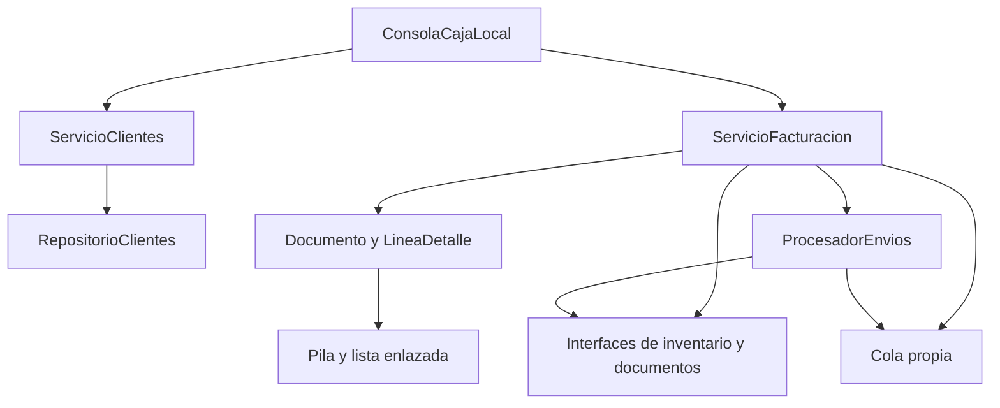

# SIFAC · Entrega 1

## Estructura de paquetes

```text
src/
└── sifac/
    ├── comun/
    │   ├── entidades/
    │   ├── estructuras/
    │   ├── datos/
    │   └── logica/
    ├── padron/
    ├── central/
    └── caja/
```

Las pruebas JUnit están bajo `test/sifac/comun`. Las demostraciones de hilos, la carrera de inventario y la verificación del padrón están en `test/sifac/pruebas`.

## Compilar y ejecutar la caja local

En NetBeans, selecciona **File → Open Project**, elige la carpeta `SIFAC_Entrega1` y ejecuta **Run Project**. La clase principal es `sifac.caja.ConsolaCajaLocal`.

## Organización de la facturación

| Paquete | Responsabilidad |
| --- | --- |
| `sifac.comun.entidades` | `Documento` y sus cuatro subclases calculan el total y determinan si la emisión descuenta inventario. `Producto`, `LineaDetalle` y `Cliente` aportan los datos del documento. |
| `sifac.comun.estructuras` | La pila de deshacer, la lista enlazada de estados y la cola de envío usan nodos propios. Las consultas de líneas e historial devuelven copias en arreglos. |
| `sifac.comun.datos` | Interfaces de clientes, inventario y documentos. Los repositorios en memoria mantienen el catálogo, las existencias, los consecutivos y los documentos. |
| `sifac.comun.logica` | `ServicioFacturacion` valida líneas, emite documentos, lista por monto, busca por número y calcula el cierre. `ProcesadorEnvios` usa un `Runnable` para entregar la cola al repositorio local que representa al central. |
| `sifac.caja` | `ConsolaCajaLocal` conecta los repositorios y servicios y presenta las operaciones en el menú. |


## Limitaciones actuales

El catálogo, las existencias, los documentos y los consecutivos se reinician con cada ejecución. El padrón incluido contiene datos sintéticos. El receptor del central se simula en memoria y un fallo de recepción conserva los pendientes durante la sesión. La facturación de esta entrega se ejecuta localmente y la integración de red y tipo de cambio corresponden a la Entrega 2.

### Criterios de negocio por confirmar

- **Impuesto y redondeo.** La caja aplica la tasa indicada para la sesión al subtotal y redondea el total del documento a dos decimales con `HALF_UP`. Confirma la tasa y el momento de redondeo.
- **Factura de crédito.** Usa el mismo cálculo de la factura de contado.
- **Nota de crédito y proforma.** La nota registra un total negativo y la proforma muestra un total estimado. El inventario se descuenta al emitir facturas.
- **Cierre.** Suma los totales con su signo de los documentos emitidos en la fecha del equipo. Confirma si este informe debe excluir algún tipo de documento.


## Archivos reutilizados

| Referencia | Archivos Java copiados |
| --- | --- |
| `sifac_Semana8` | `DemoEstados.java`, `DemoPrioridades.java`, `DemoThreadVsRunnable.java`, `ClienteConsulta.java`, `RepositorioPadron.java`, `Distrito.java`, `Elector.java`, `AtencionCliente.java`, `ServidorConcurrente.java`, `ServidorSecuencial.java` |
| `sifac_Caja` | `ConsolaCaja.java` (adaptada), `EnviarDocumento.java`, `CentralDemo.java`, `ProtocoloPadron.java`, `RepositorioClientes.java`, `RepositorioClientesPadron.java`, `ServicioPadronException.java`, `Cliente.java`, `ServicioClientes.java`, `VerificarPadron.java` |
